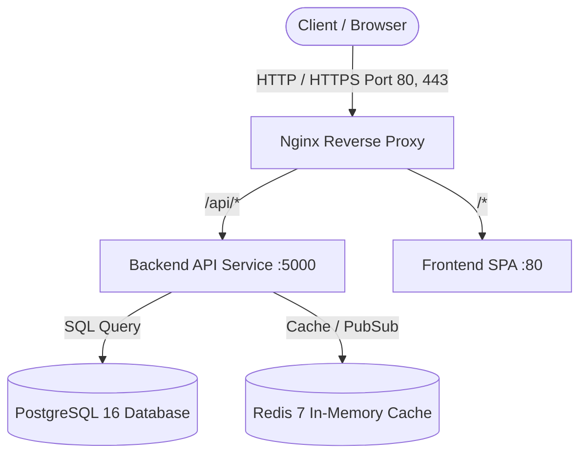

# Kiến Trúc Hệ Thống (System Architecture)

## 1. Tổng quan mô hình

Dự án **MatchingTeam** áp dụng kiến trúc **Modular Monolith** kết hợp Containerization (Docker), giúp đội ngũ phát triển dễ dàng mở rộng, kiểm thử và chuyển đổi sang Microservices khi lượng truy cập tăng đột biến.

## 2. Các tầng phân quyền & luồng xử lý

1. **Client Tier**: Single Page Application (React, Vite, TypeScript) phục vụ bởi Nginx với cấu hình SPA fallback.
2. **Gateway Tier**: Nginx Reverse Proxy điều hướng request, nén Gzip, quản lý SSL và cân bằng tải.
3. **Application Tier (Backend)**:
   - **Modules**: Mỗi tính năng (`auth`, `teams`, `matching`, `users`) nằm trong một thư mục khép kín (Controller -> Service -> Data Access).
   - **Common**: Chứa các middleware dùng chung, xử lý lỗi tập trung, format response chuẩn RESTful.
4. **Data Tier**:
   - **PostgreSQL**: Lưu trữ dữ liệu quan hệ có cấu trúc và tính toàn vẹn (ACID).
   - **Redis**: Lưu trữ session, blacklist token, cache danh sách gợi ý và message broker cho real-time events.

## 3. Khả năng mở rộng (Scalability)

- **Thêm tính năng mới**: Chỉ cần thêm một thư mục mới trong `backend/src/modules/<feature_name>` và `frontend/src/features/<feature_name>`. Không làm ảnh hưởng đến code của các module hiện có.
- **Tách Microservices**: Do các module được đóng gói độc lập theo domain, khi một module (ví dụ: `matching` algorithm) cần nhiều tài nguyên CPU, ta có thể tách riêng thành 1 service độc lập mà không cần viết lại toàn bộ code.
- **Cân bằng tải (Horizontal Scaling)**: Chỉ cần tăng replica backend trong Docker Compose (`docker compose up --scale backend=3 -d`).
